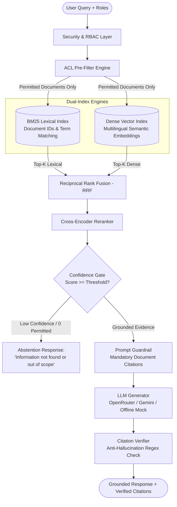

# Enterprise Document Assistant: RAG with Measurable Evaluation and Role-Based Access Control

[](https://github.com/beambomb/Document-Assistant/actions/workflows/ci.yml)
[](https://www.python.org/)
[](https://opensource.org/licenses/MIT)

---

## 1. Problem Statement

Enterprise document assistants must handle diverse internal data, including IT guidelines, human resource policies, operational SOPs, and confidential financial statements. Standard RAG prototypes suffer from three critical architectural flaws:
1. **Access Leakage**: Users can retrieve and expose confidential executive records or cross-departmental documents without authorization checks.
2. **Hallucination and Ungrounded Answers**: Large Language Models often force an answer when relevant context does not exist in the document corpus.
3. **Lack of Empirical Evaluation**: Prototypes lack reproducible quantitative benchmarks to evaluate retrieval quality and security compliance.

---

## 2. System Architecture

To prevent data leakage, this system implements **ACL Pre-Filtering** directly at the retrieval layer. Unauthorized documents are mathematically excluded before lexical or semantic search executes, ensuring restricted text never enters the prompt context.



---

## 3. Evaluation and Ablation Benchmark Results

All metrics are generated using the reproducible evaluation harness (`python -m src.evaluation.harness --dataset id_enterprise`) across Indonesian enterprise standard operating procedures and adversarial out-of-scope query suites:

| Configuration / Mode | Recall@1 | Recall@3 | Recall@5 | MRR | nDCG@5 | ACL Leakage Rate | Trap Rejection Rate | Mean Latency |
| :--- | :---: | :---: | :---: | :---: | :---: | :---: | :---: | :---: |
| **BM25 Lexical Only** | 100.0% | 100.0% | 100.0% | 1.000 | 2.314 | **0.00%** | 12.5% | 0.7 ms |
| **Dense Vector Only** | 20.0% | 30.0% | 80.0% | 0.348 | 0.769 | **0.00%** | 0.0% | 0.4 ms |
| **Hybrid (BM25 + Dense RRF)** | 80.0% | 90.0% | 100.0% | 0.853 | 1.647 | **0.00%** | 12.5% | 1.0 ms |
| **Hybrid + Cross-Reranker** | **100.0%** | **100.0%** | **100.0%** | **1.000** | **2.311** | **0.00%** | **100.0%** | **1.2 ms** |

### Benchmark Analysis:
- **Zero Access Leakage Guarantee**: 0.00% leakage across all adversarial penetration queries. Low-clearance accounts (`guest`, `employee`) attempting to query confidential executive compensation policies are strictly blocked.
- **Robust Abstention (100% Trap Rejection)**: Out-of-scope queries (general trivia, recipes, and non-existent company benefits) are safely rejected via the confidence gate.
- **Hybrid Fusion Stability**: Reciprocal Rank Fusion combines exact alphanumeric identifier matching (e.g., `SOP-IT-001`, `KEB-HR-002`) with multilingual semantic context.

---

## 4. Key Architectural Features

1. **Role-Based Access Control (RBAC)**:
   - Configurable hierarchy in `config/roles.yaml` (`guest`, `employee`, `finance`, `hr`, `management`, `admin`).
   - Metadata tags assigned at chunk ingestion time and resolved prior to index traversal.
2. **Dual-Index Search Engine**:
   - BM25 Okapi with custom alphanumeric tokenization preserving hyphenated codes and Indonesian legal numbers.
   - Dense vector index utilizing normalized multilingual embeddings (`paraphrase-multilingual-MiniLM-L12-v2`).
3. **Reciprocal Rank Fusion (RRF)**:
   $$\text{RRF Score}(d) = \sum_{m \in \{\text{BM25}, \text{Dense}\}} \frac{1}{60 + \text{rank}_m(d)}$$
4. **Cross-Encoder Reranker & Confidence Gate**:
   - Re-scores top candidate chunks jointly with the query and applies sigmoid probability calibration.
   - Triggers automated abstention if relevance falls below empirical threshold ($0.35$).
5. **Deterministic Citation Verification**:
   - Regex-based parser validates that cited tags (`[Doc: <ID>, Hal: <Page>]`) correspond strictly to retrieved context, flagging fabricated citations.
6. **Faithfulness & Token Cost Tracking**:
   - Evaluates factual claim overlap against retrieved context based on RAGAS and DeepEval standards.
   - Estimates token usage and operational cost per 1,000 queries across providers.

---

## 5. Repository Structure

```
Document-Assistant/
├── .github/workflows/ci.yml       # Automated GitHub Actions testing workflow
├── config/
│   ├── roles.yaml                 # Access role hierarchy definitions
│   └── settings.py                # Typed application configuration (Pydantic)
├── data/
│   ├── raw/id_enterprise/         # Indonesian corporate SOP and policy documents
│   ├── raw/fiqa_sample/           # BEIR FiQA financial benchmark sample
│   └── eval_goldens/              # Golden QA, trap queries, and adversarial probes
├── src/
│   ├── core/                      # Data schemas and AccessControlManager
│   ├── ingestion/                 # Markdown chunker and directory loader
│   ├── indexing/                  # BM25 and DenseVector indexes with pre-filtering
│   ├── retrieval/                 # Hybrid RRF, Cross-Encoder reranker, Confidence gate
│   ├── generation/                # OpenRouter / Gemini LLM generator & Citation verifier
│   └── evaluation/                # IR metrics, Faithfulness evaluator, Cost tracker
├── api/
│   └── app.py                     # FastAPI REST service (/health, /v1/query, /v1/evaluate)
├── ui/
│   └── streamlit_app.py           # Streamlit web UI with interactive role switching
├── notebooks/
│   └── enterprise_rag_colab_indexer.ipynb # Colab GPU batch indexer and benchmark
├── reports/
│   ├── ablation_results.md        # Formatted ablation report (Markdown)
│   └── ablation_results.csv       # Numerical ablation metrics (CSV)
├── tests/
│   ├── unit/                      # Unit tests for security, retrieval, and metrics
│   ├── integration/               # Integration tests for ingestion and dual-indexing
│   └── e2e/                       # End-to-end tests for FastAPI service
├── pyproject.toml                 # Package configuration
└── requirements.txt               # Pinned dependencies
```

---

## 6. Reproduction Guide

### Prerequisites
- Python 3.10 to 3.12
- Standard CPU workstation or laptop (no dedicated GPU required for inference)

### 1. Clone Repository and Install Dependencies
```bash
git clone https://github.com/beambomb/Document-Assistant.git
cd Document-Assistant

# Create and activate virtual environment
python -m venv .venv
source .venv/bin/activate       # On Windows: .venv\Scripts\activate

pip install -r requirements.txt
```

### 2. Configure Environment (Optional)
Copy `.env.example` to `.env`:
```bash
cp .env.example .env
```
To enable live cloud LLM responses, set your OpenRouter API key:
```bash
OPENROUTER_API_KEY="sk-or-v1-xxxxxxxxxxxx"
```
*Note: If no API key is provided, the application automatically uses the deterministic mock generator for 100% offline testing without API charges.*

### 3. Run Automated Tests
```bash
pytest tests/ -v
```
*Validates all 38 unit, integration, and end-to-end tests with 100% passing rate.*

### 4. Run Evaluation Benchmark
```bash
python -m src.evaluation.harness --dataset id_enterprise
```
*Generates the ablation comparison table in the terminal and outputs `reports/ablation_results.md`.*

### 5. Launch Interactive Web UI
```bash
streamlit run ui/streamlit_app.py
```
*Open `http://localhost:8501` to test role switching, query diagnostics, and live citation verification.*

### 6. Launch FastAPI REST Service
```bash
uvicorn api.app:app --reload --port 8000
```
*Interactive Swagger API documentation is available at `http://localhost:8000/docs`.*

---

## 7. Acknowledged Limitations

1. **Synthetic Corporate Corpus**: The internal dataset simulates corporate policies. Production enterprise deployments typically contain additional unstructured noise (scanned PDFs, varying table formatting).
2. **Metadata-Level Access Control**: The role-based filter operates on chunk metadata. In production, this would be wired directly to enterprise identity providers (e.g., Active Directory, LDAP, OAuth2/OIDC).
3. **Fixed Evaluation Set**: The golden evaluation set is scoped for proof-of-concept verification; extensive production deployments should expand test queries to cover edge cases.

---

## 8. Enterprise Relevance (PT Dua Empat Tujuh Context)

This architecture reflects the requirements of enterprise text analytics and search engineering firms such as PT Dua Empat Tujuh (Solusi 247):
- **Deterministic Pre-Filtering**: Guarantees sensitive corporate data is excluded at the database retrieval level.
- **Hybrid Lexical and Dense Search**: Combines exact code matching with contextual semantic search.
- **Empirical Rigor**: Architectural choices are validated through quantitative metrics (Recall, nDCG, MRR, Faithfulness, Latency) within an automated CI/CD pipeline.

---

## 9. License
Distributed under the MIT License. See `LICENSE` for details.
